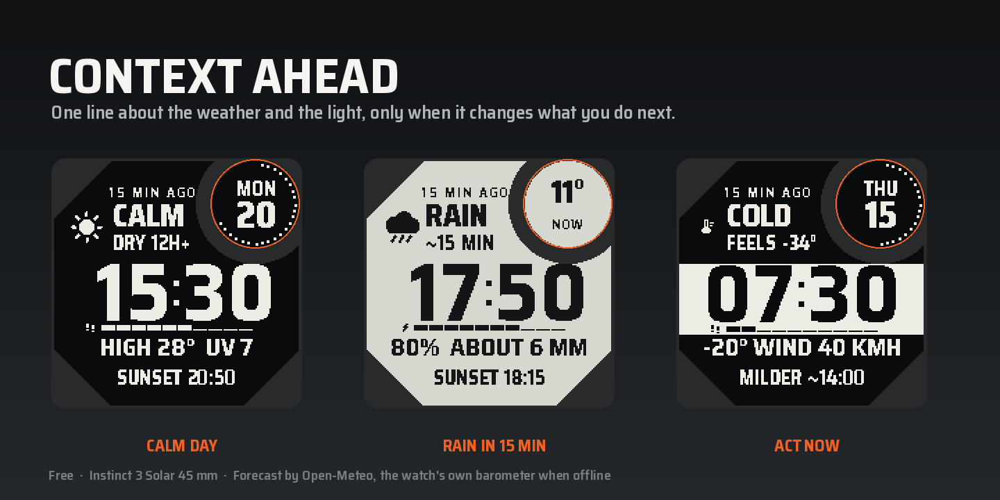

# Context Ahead (Instinct 3 Solar)

A free watch face for the Garmin Instinct 3 Solar (45 and 50 mm). It tells you what the weather and the light will do next, in one line, with a large, always-readable time. When nothing matters, it says so.

`store/` holds the store listing (`STORE.md`) and every image. `CONTEXT.md` gives the rules that pick the message. `tools/sim/REPORT.md` holds the evidence behind those rules.

## The face

| Zone | What it shows |
| --- | --- |
| Top line | The forecast's age ("12 MIN AGO", "4 H AGO"), or why there is none ("NO PHONE", "NO GPS", "SERVER BUSY") |
| Signal | One message: an icon, a word and its detail ("RAIN / ~15:00", "GUST / 72 KMH", "CALM / DRY 12H+") |
| Circle | Yours: weekday and date with a month arc (default), weather now (this hour's picture over the temperature, the arc showing the highest rain chance of the next 3 hours), pressure, moon, steps against your goal, intensity minutes today or this week, heart rate, Body Battery, stress, altitude, battery days, solar intensity, notifications, seconds on wrist raise, or off |
| Time | Large solid digits. They invert (black on white) when something needs acting on now |
| Bar | Yours: steps, floors, intensity today or this week, move bar, Body Battery, stress, battery, solar intensity, or off |
| Line 1 | How much: the amount, the chance, the strength |
| Line 2 | When it changes, or what follows |

A wrist raise adds, it never replaces: one more fact appears under line 2 (when it is heaviest, the peak gust, tonight's low, the reading behind an air index), and the bar's value appears at its right end. No number or time is shown twice on one screen; the checks enforce it.

## Context

Context is the one weather or light message most likely to change what you do next. It is chosen by tier:

1. Act now
2. Light nearly gone
3. Rain or snow within 2 hours
4. Light running out
5. Worth adapting to
6. Quiet

Four rules matter most:

- **Honest timing.** A minute countdown ("~45 MIN") appears only where the forecast model really works in 15-minute steps: Central Europe and the conterminous US. Everywhere else, times are given to the hour ("~15:00").
- **Urgency needs fresh data.** Act-now messages need a forecast under 90 minutes old. As a forecast ages, it first loses urgency, then says that it is old ("GUST / 4H OLD").
- **No invented storms.** The atmosphere's storm energy (CAPE) alone never makes a storm message. A pressure fall counts only when the watch did not climb or descend.
- **Quiet is useful.** On calm days the face shows dawn, the morning briefing, sunshine still to come, tomorrow after sunset, and the moon at night.

The full rules are in `CONTEXT.md`.

## Settings

Change them on the watch (hold MENU > Watch Face > Customize) or in the Garmin Connect app. Defaults are in bold.

The watch menu is one small view in Solar Frontier's style, not Menu2: UP/DOWN move, GPS opens a setting and saves the highlighted option (CURRENT marks the stored one), BACK cancels or closes. The face frees its fonts while the menu is open.

| Setting | Options |
| --- | --- |
| Circle | **Date**, Weather now, Pressure, Moon, Steps, Intensity today, Intensity week, Heart rate, Body Battery, Stress, Altitude, Battery days, Solar intensity, Notifications, Seconds (wrist raise), Off |
| Bar under the time | **Steps**, Floors, Intensity today, Intensity week, Move bar, Body Battery, Stress, Battery, Solar intensity, Off |
| Time format | **Watch setting**, 24 hours, 12 hours |
| Weather update | Every 5, 10, 15, 20, **30**, 45, 60 or 90 min, every 2 hours |
| Pollen in Context | **Off**, On (Europe) |
| Theme | **Dark**, Light |
| Air quality index | **Auto** (European in Europe, US elsewhere), European (EU AQI), US (US AQI) |

Units follow the watch:

- **Temperature setting:** temperatures, plus rain and snow amounts (inches with °F).
- **Distance setting:** wind (km/h or mph) and visibility.
- **Elevation setting:** altitude and the snow line.

## Weather and data

Weather comes from **Open-Meteo**. It is free with no account or key, and is fetched by a background task through the phone. Air quality comes from the **Copernicus Atmosphere Monitoring Service** (CAMS) via Open-Meteo, at most once an hour. It uses the EU AQI in Europe and the US AQI elsewhere unless the setting picks one, with a 12-hour forecast of the index and dust so the face can say when the air improves.

From Open-Meteo, the face uses the hourly temperature, humidity, weather code, rain chance, precipitation, snowfall, wind, gusts, visibility, UV, cloud cover, snowfall height and sunshine for the next 20 hours, plus the freezing level outside Central Europe. It also uses the daily high and low, UV maximum, sunshine, rain and snow totals, moonrise, moonset and moon phase, plus 15-minute precipitation (requested only where it is native).

From the watch itself, it uses:

- the last GPS fix, for position and sun times (the face's own formula, within about 2 minutes of NOAA);
- pressure and elevation history, for the barometer trend and to check whether the watch was climbing;
- the live sea-level pressure.

Credits: weather data by Open-Meteo.com (CC BY 4.0); air quality and pollen from CAMS. The free Open-Meteo service is for non-commercial use, under 10,000 calls a day. One watch makes at most 288 forecast calls a day at the 5-minute setting, plus at most 24 air-quality calls.

About the update interval: 5 minutes is the shortest a Connect IQ background event can run, and each fetch costs some battery. At 90 minutes and 2 hours, the forecast passes Context's 90-minute limit for act-now and rain-within-2-hours messages before the next fetch arrives, so for the end of each cycle those messages step down instead of claiming urgency on old data. 30 minutes or shorter keeps them live all the time.

**Privacy:** the face sends its approximate position (two decimals) to Open-Meteo, and nothing else. No data is collected.

## Build

1. Install the Connect IQ SDK with Garmin's SDK Manager, with the **Instinct 3 Solar 45mm / 50mm** device. You also need Java 17+.
2. Run `.\build.ps1` (Windows) or `./build.sh`. Add `-Sim` / `--sim` to open the simulator; File > View Memory shows Peak Memory.
3. To sideload, copy `bin/ContextAhead.prg` to `GARMIN/APPS` on the watch.
4. For the store package, run `.\build.ps1 -Export` (or `./build.sh --export`). It writes `bin/ContextAhead.iq`, signed with your developer key in `%USERPROFILE%\.connectiq\developer_key.der`. Keep that key: every update must use it.

App ID: `ae5d5b72-f196-4d58-944a-6011d6e3ced0`. It is new, so the face does not collide with Solar Frontier.

### Generated files

`python3 tools/make_project.py` regenerates these from Saira Semi Condensed. Point `SAIRA_FONT_DIR` at the Google Fonts TTFs.

- the word, tiny and icon fonts;
- `source/Ic.mc` and `source/SetText.mc`;
- the phone settings;
- the launcher icon.

The time, small, big, mid and med fonts are Solar Frontier's. `tools/store_assets.py` redraws the store images with the face's own fonts and coordinates (`tools/preview.py`).

## Memory

The forecast is the largest thing the face keeps. Three choices keep it small:

- **Packed hours.** The 14 hourly series travel as 4 arrays of whole numbers, several fields per number (`WeatherService.mc` packs them, `Context.hv` unpacks them). A day of forecast takes about a third of the memory and storage it did.
- **Air quality apart.** It arrives at most hourly and is stored on its own (`"aq"`), so a new forecast never has to reload the old one to keep it.
- **One copy at a time.** Before a new forecast is written to storage, the face drops the old one, its air data, its last message and its fonts (they reload on the next redraw). If free memory is still under 5 kB, the forecast is kept in memory only that time instead of risking an out-of-memory stop.
- **Menu texts on demand.** Each setting's menu texts are one string resource ("Title|Option|..."), loaded only while the menu shows it. As constants (strings or resource ids alike) they cost code and data for the whole time the face ran.

The test harness packs the simulation's weather the same way (`tools/check/pack.cjs`), so the checks run on the real layout. The packed and unpacked engines give identical texts on all 85 situations.

## Settings after the first release

Never remove or reorder an option in the middle of a list: stored values are positions, so later options would change meaning. Replace an option in its slot with something close, or remove only the last one (an out-of-range stored value falls back to the default). To retire a whole setting, keep its key number, drop it from the menu and the phone settings, and shrink its list to one entry.

## Testing every forecast path

Run the simulator in three places, setting both the position and the time zone: a native 15-minute area (Munich or New York, minute countdowns), an hourly area (Bucharest, "BY 16:00" and the hourly paths), and North America for the US air index. Code that only runs in one of them is only tested there.

## Checks without the SDK

`bash tools/check/check.sh` needs Node 18+ and Python 3. It runs four checks:

1. It parses every source file with a Monkey C parser.
2. It lints for duplicate locals, unknown names, unknown members of the project's modules, private members used from outside, and wrong argument counts.
3. It transpiles `Context.mc` to JavaScript on a strict runtime and runs it on the 85 situations of the simulation (`tools/sim`). The runtime models Monkey C's integer and float arithmetic, and crashes on null arithmetic, out-of-range indexes, Number + String, and Float.format("%d").
4. It runs the same code on 80,000 random weather situations, with missing fields, all unit settings, both clock formats, and six time zones.

**Last run:**

- No parse or lint problems.
- 0 crashes on the 85 situations, in metric and imperial.
- 0 crashes on the 80,000 random cases.
- Every text fits the panel, measured with the real fonts.

These checks do not replace the compiler, the simulator's memory report, or a test on the watch.

## Before each upload

Status: live in the Connect IQ store. 1.2.1 is the build of Nov 3, 2026; 1.3 and 1.4 are builds of Nov 12; this source is 1.5 (Nov 18, 2026). Measured (1.5): code 35,192 B, data 9,000 B, 55.9 kB in use, 57.1 kB peak, 58.3 kB peak stack trace of 59.9 kB (1.4: 54.6, 55.7, 57.0). About 1.6 kB is left at the worst moment: a new feature should come with something removed. Before each upload, run the steps below.

1. **Build in the simulator.** Fix any compiler or type-checker messages.
2. **Measure Peak Memory** (File > View Memory) with the heaviest settings: circle Body Battery, bar Stress, pollen on, updates every 5 minutes, light theme, and trigger a background event so a new forecast is stored while the face runs.
3. **Test the background fetch** with the simulator's background-event trigger, and on the watch. If the reply runs out of memory (error -403), the face switches to 16 hours by itself.
4. **On the watch, check:**
   - a full day of messages;
   - a wrist raise;
   - the settings menu, and both themes;
   - airplane mode (the forecast age, then the barometer or sun);
   - a clock change, if one falls in the test period.

Crash logs are in `GARMIN\APPS\LOGS\CIQ_LOG.YML`. Map them with the `.prg.debug.xml` from exactly the same build.

## Licences

- **Code:** GNU GPL v3.0 or later (`LICENSE`). Context Ahead reuses parts of Solar Frontier, which is GPL-3.0: the sun formula, the background fetch pattern, the time placement and the font tools.
- **Fonts:** "Context Ahead Pixel" is a Modified Version of Saira Semi Condensed by Omnibus-Type, under the SIL Open Font License 1.1 (`OFL-SairaSemiCondensed.txt`). It is renamed because the licence reserves the name "Saira".
- **Data:** Open-Meteo.com (CC BY 4.0); CAMS.
- **Trademarks:** Garmin, Instinct and Connect IQ are trademarks of Garmin Ltd. This project is not affiliated with or endorsed by Garmin.

Written with the help of AI assistants (Anthropic's Claude).
